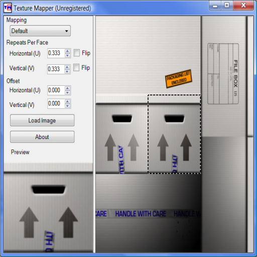

# Texture Mapper

A small Windows tool from 2010 for Second Life builders. Load a texture, drag a box around the part you
want on a face, and it gives you the **repeats per face** and **offset** values to type into Second
Life's texture settings, with a preview of the result.

*Texture Mapper 1.0 (unregistered), from a snapshot I uploaded to Second Life in 2010.*

## Features

- Drag to select, then drag the edges or corners to resize the selection or the middle to move it.
  Double-click to reset.
- Type repeats and offsets directly. The selection follows.
- **Default** and **Planar** mapping, matching Second Life's two texture mapping modes.
- Flip horizontally or vertically.
- A preview of the selected area as it would tile on the face.
- Loads BMP, JPEG, GIF and PNG. It opens with a sample "file box" texture.

## Registration

The program was free, but it asked to be registered. Unregistered copies show "Texture Mapper
(Unregistered)" and open the About box every five minutes. If you close it without registering, the program
exits.

You registered in Second Life. Touching the **Texture Mapper Software Registration** object told its owner
their serial number and gave them the download link. The script is in
[`second-life/`](second-life/Texture%20Mapper%20Software%20Registration.lsl). The serial is the
uppercased characters 5–20 of `SHA1(avatar name + secret)`. The program checks it the same way in
`AboutBox1.IsValid` and saves the name and serial in the user's registry.

## How this source was recovered

Only the published ClickOnce build survived (`TextureMapper_1_0_0_0`, assembly version
1.0.3693.8239, built February 10, 2010). The source in this repository was decompiled from that build with
ILSpy, then rebuilt as a Visual Studio 2008 project:

- The forms are split back into `Form1.cs` / `Form1.Designer.cs` and `AboutBox1.cs` /
  `AboutBox1.Designer.cs`, the way the Windows Forms designer lays them out.
- The two images (`FileBox.png`, the sample texture, and `Gravatar.jpg`, the About box picture) and
  the icon were extracted from the program's resources.
- Names of classes, methods, fields and controls are the originals. Local variable names and comments
  were not kept by the compiler, so local names are ILSpy's and there are no comments.

**Check:** I compiled the recovered source against the .NET Framework 2.0 reference assemblies and
decompiled the result again. Every class decompiles to the same code as the original program, except
two spots where today's C# compiler writes the same logic differently (`Length != 0` for `Length > 0`,
and a `== null` check in the generated `Resources` class).

## Building

Open `TextureMapper.sln` in Visual Studio (2008 or later) and build. It targets .NET Framework 2.0 and
runs on Windows.

## Files

| Path | What it is |
|---|---|
| `TextureMapper/` | The recovered Visual Studio 2008 project |
| `second-life/` | The in-world registration script (LSL, February 10, 2010) |
| `docs/` | The 2010 snapshot |

The original published files (`setup.exe`, the ClickOnce manifests and `TextureMapper.exe.deploy`) are in
the ZIP attached to the `v1.0` release.

Copyright © 2008–2010 Lewis Moten. All rights reserved.
