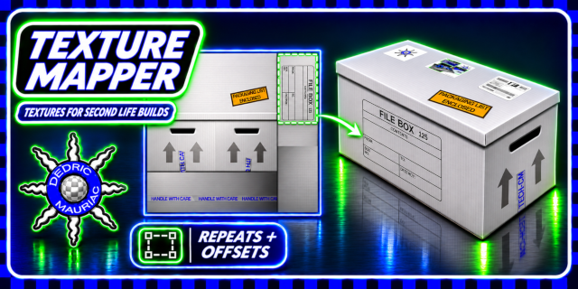

# Texture Mapper

A small tool for Second Life builders. Load a texture, drag a box around the part you want on a face,
and it gives you the **repeats per face** and **offset** to type into Second Life's texture settings,
with a preview of the result. I wrote it as a Windows program in 2008 and released it in 2010. It's free
now and also runs in your browser.

**Use it in your browser: https://lewismoten.github.io/texture-mapper/**

*Texture Mapper 1.0 (unregistered), from a snapshot I uploaded to Second Life in 2010.*

## Why

One uploaded image can cover many faces if each face shows only part of it. That means one upload fee
instead of several, and the build loads faster because viewers download one texture. My product box was
the classic example: one prim, one texture, a different look from each side. Working out the numbers by
hand was tedious unless the image was laid out in a strict grid, so I wrote a program that let me draw a
box on the image and read the numbers off.

## Features

- Drag to select, then drag the edges or corners to resize the selection or the middle to move it.
  Double-click to clear.
- Type repeats and offsets directly. The selection follows.
- **Default** and **Planar** mapping, matching Second Life's two texture mapping modes.
- Flip horizontally or vertically.
- A preview of the selected area.
- Loads BMP, JPEG, GIF and PNG. It opens with a sample "file box" texture.

The web version does the same math and adds a few things: it keeps the image's proportions, shows the
preview wrapping past the image edges the way Second Life repeats a texture, takes dropped or pasted
images, lets you nudge the box with the arrow keys, and gives you an LSL line (`llSetPrimitiveParams`)
with the values. Images stay in your browser and are never uploaded.

## From the blog

- [Texture Mapper](https://dedricmauriac.wordpress.com/2008/08/06/texture-mapper/), August 6, 2008: why I
  started it, with a beta screenshot.
- [Texture Mapper Flipping](https://dedricmauriac.wordpress.com/2008/08/07/texture-mapper-flipping/),
  August 7, 2008: flipping and planar mapping added; rotation still giving me trouble.
- [Texture Mapper Released](https://dedricmauriac.wordpress.com/2010/02/10/texture-mapper-released-2/),
  February 10, 2010: the release, without rotation
  ([also on lewismoten.com](https://lewismoten.com/2010/02/10/texture-mapper-released-dedric-mauriac/)).
- [Texture Mapper Examples](https://dedricmauriac.wordpress.com/2010/04/13/texturemapper-examples/),
  April 13, 2010: a builder's shop made from one 512×512 texture.

## Registration (historical)

The Windows program was free to try but asked to be registered. Unregistered copies show "Texture
Mapper (Unregistered)" and open the About box every five minutes. If you close it without registering,
the program exits.

You registered in Second Life. Touching the **Texture Mapper Software Registration** object told its owner
their serial number and gave them the download link. The script is in
[`second-life/`](second-life/Texture%20Mapper%20Software%20Registration.lsl). The serial is the
uppercased characters 5–20 of `SHA1(avatar name + secret)`. The program checks it the same way in
`AboutBox1.IsValid` and saves the name and serial in the user's registry. I no longer sell it, so the
secret is published here and anyone can register. The web version needs no registration. Its **About**
button opens an About box like the program's, and that box makes a serial for any name, so the old
program can still be unlocked. I checked it against the program's own `IsValid` code run under .NET.

## How the Windows source was recovered

Only the published ClickOnce build survived (`TextureMapper_1_0_0_0`, assembly version
1.0.3693.8239, built February 10, 2010). The source in `TextureMapper/` was decompiled from that build
with ILSpy, then rebuilt as a Visual Studio 2008 project:

- The forms are split back into `Form1.cs` / `Form1.Designer.cs` and `AboutBox1.cs` /
  `AboutBox1.Designer.cs`, the way the Windows Forms designer lays them out.
- The two images (`FileBox.png`, the sample texture, and `Gravatar.jpg`, the About box picture) and
  the icon were extracted from the program's resources.
- Names of classes, methods, fields and controls are the originals. Local variable names and comments
  were not kept by the compiler, so local names are ILSpy's and there are no comments.

**Check:** I compiled the recovered source against the .NET Framework 2.0 reference assemblies and
decompiled the result again. Every class decompiles to the same code as the original program, except
two spots where today's C# compiler writes the same logic differently (`Length != 0` for `Length > 0`,
and a `== null` check in the generated `Resources` class).

## Building and running

- **Web:** serve the `docs/` folder with any web server (for example `python3 -m http.server -d docs`)
  and open it. There is no build step. Run the tests with `node --test test/`.
- **Windows:** open `TextureMapper.sln` in Visual Studio (2008 or later) and build. It targets .NET
  Framework 2.0. The 2010 release post said to install .NET 3.5.

## Files

| Path | What it is |
|---|---|
| `docs/` | The web version (GitHub Pages): `index.html`, `app.js`, `mapper.js` (the math), `style.css` |
| `test/` | Tests for the web version's math |
| `TextureMapper/` | The recovered Visual Studio 2008 project |
| `second-life/` | The in-world registration script (LSL, February 10, 2010) |

The original published files (`setup.exe`, the ClickOnce manifests and `TextureMapper.exe.deploy`) are in
the ZIP attached to the `v1.0` release.

## License

MIT. See [LICENSE](LICENSE).
